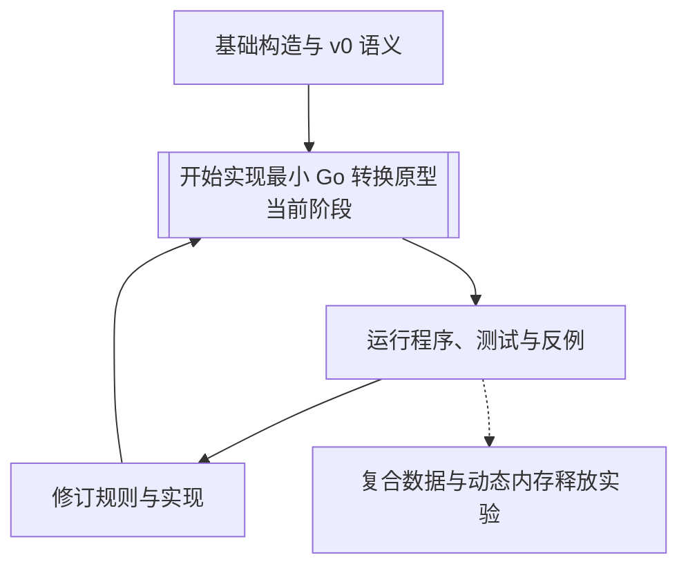

# Fini 文档

## 语言参考

- [概述](spec/README.md)：语言范围与原型实现。
- [语法](spec/syntax-v0.md)：源码写法和代码块结构。
- [语义](spec/v0.md)：类型、名称、函数、求值和错误。

语言参考是 v0 设计草案。尚未定义的规则集中列于 [设计问题](questions/01-language-design.md)。

## 研究笔记

- [基础构造与内存释放](notes/01-foundations.md)：从 SICP 的基本元素、组合与抽象出发分析语言能力。
- [v0 设计取舍](notes/02-v0-candidate.md)：最小模型的理由、代价和局限。
- [Go 与 Rust 的设计过程](notes/03-language-development.md)：官方历史资料与设计、原型、验证交替推进的方法。

研究笔记解释设计依据，不另定义语言行为。

## 设计问题

[待解决问题](questions/01-language-design.md) 按语法、运行接口和动态数据分类。语法问题逐项列出选项、影响和建议。

## 开发路线

当前准备实现 Go 转换原型，路线见 [项目说明](../README.md#实现)。先让一个返回整数的最小程序完成解析、检查、生成和执行，再逐项加入语言能力，通过程序、测试和反例检验 v0 规则。词法与排版的开放问题不阻止实验。

第一版验证应覆盖正常计算、名称与类型错误、整数越界、求值顺序和未执行分支。动态数据阶段再验证存储共享、函数返回、分支汇合和释放位置。
